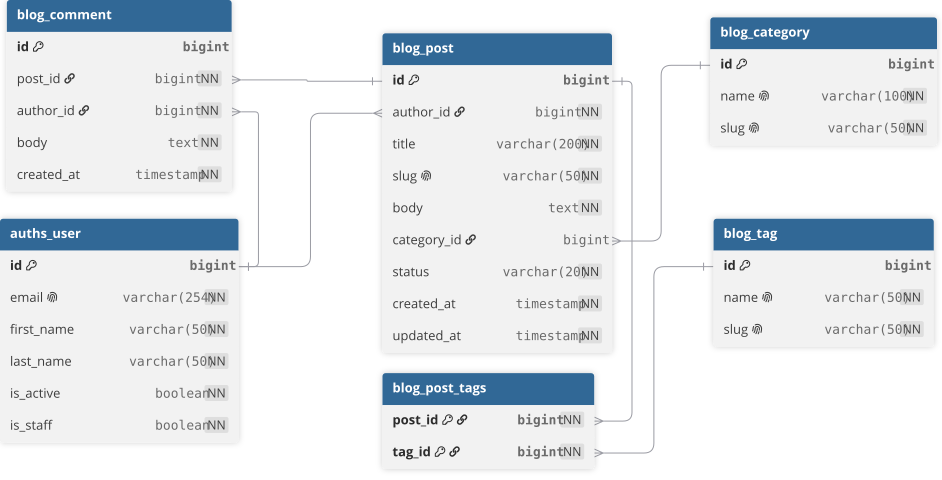

# Blog API

A Django REST API project with a custom user model, blog content models, database seeding, and an Unfold-powered administration panel.

## Technologies

- Python 3.11
- Django 5.2
- Django REST Framework
- PostgreSQL
- Django Unfold
- Faker

## Project structure

```text
blog-api/
├── apps/
│   ├── auths/
│   └── blog/
├── docs/
│   ├── screenshots/
│   └── erd.svg
├── requirements/
├── settings/
│   ├── .env.example
│   └── base.py
├── templates/
├── manage.py
└── README.md
```

## Setup

### 1. Clone the repository and enter the project directory

```powershell
git clone <repository-url>
cd blog-api
```

### 2. Create and activate a virtual environment

```powershell
python -m venv env
.\env\Scripts\Activate.ps1
```

### 3. Install dependencies

```powershell
pip install -r requirements/base.txt
pip install -r requirements/dev.txt
```

### 4. Configure environment variables

Create your local environment file from the example:

```powershell
Copy-Item settings/.env.example settings/.env
```

Update `settings/.env` with your local PostgreSQL credentials and a private Django secret key.

The environment file should contain these variables:

```env
BLOG_ENV_ID=local
BLOG_SECRET_KEY=replace-with-a-secret-key
BLOG_DEBUG=True
BLOG_REDIS_URL=redis://localhost:6379/0
BLOG_DB_NAME=blog
BLOG_DB_USER=postgres
BLOG_DB_PASSWORD=your-database-password
BLOG_DB_HOST=localhost
BLOG_DB_PORT=5432
```

Do not commit `settings/.env` or expose your real secret key or database password.

### 5. Create the PostgreSQL database

Create a PostgreSQL database matching `BLOG_DB_NAME` in your environment file. Make sure the configured database user has permission to access it.

### 6. Apply migrations

```powershell
python manage.py migrate
```

### 7. Generate sample data

The seed command creates users, categories, tags, posts, and comments.

```powershell
python manage.py seed
```

Default counts:

- 20 users
- 100 posts
- 500 comments

Custom counts:

```powershell
python manage.py seed --users 5 --posts 20 --comments 50
```

Clear generated blog data and reseed:

```powershell
python manage.py seed --clear
```

Use custom counts while clearing:

```powershell
python manage.py seed --clear --users 5 --posts 20 --comments 50
```

The `--clear` option removes comments, posts, tags, and categories, and removes non-superuser accounts. Existing superusers are preserved.

Seeded accounts use the password defined by the `SEED_PASSWORD` constant in the seed command. Change this value before using seeded accounts in any environment that matters.

### 8. Create an administrator account

```powershell
python manage.py createsuperuser
```

### 9. Run the development server

```powershell
python manage.py runserver
```

Open the administration panel at:

```text
http://127.0.0.1:8000/admin/
```

## Administration panel

The project uses Django Unfold for its administration interface.

The admin panel provides:

- A dashboard with user, post, draft, and comment statistics.
- A chart showing posts per category.
- A top-authors table and published/draft progress indicators.
- Post, comment, category, and tag management.
- Post status tabs, filters, search, comment counts, and bulk publishing actions.
- User management, including bulk activation and deactivation.
- Group management.

## Screenshots

Screenshots of the administration panel are available in `docs/screenshots/`:

| Screenshot | File |
|---|---|
| Dashboard | `dashboard.png` |
| Post list and filters | `post-list.png` |
| Post edit page | `post-edit.png` |
| User list | `user-list.png` |

## Entity-Relationship Diagram


